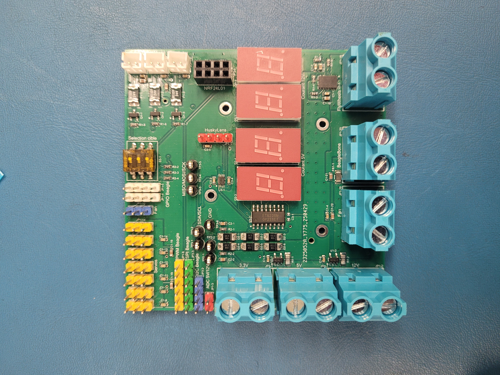
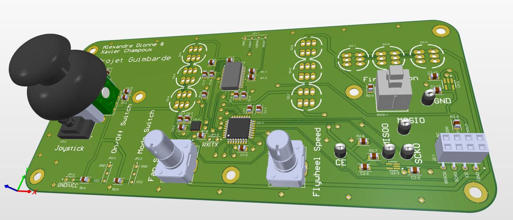

## Automated Target-Aiming Turret

https://github.com/user-attachments/assets/4edb1a01-b221-450d-96cd-c2e2fe770a61

This system was developed as the final capstone project for the Programmable Electronics Advanced Diploma (DEC) at Cégep Limoilou. The scope of the project required a complete hardware and software engineering design within a strict 13-week timeline.

---

## Hardware Engineering

### 1. Custom PCB Design (`/hardware`)


* **Turret Control Board:** Designed a **4-layer PCB** integrating connections for high-torque servo motors, flywheel DC motors, power management blocks, RF modules, and a BeagleBone Blue system. It features an onboard current sensor to monitor live system power consumption.


* **Remote Controller Board:** Designed a dedicated manual controller board driven by an **ATmega328PB MCU**. Integrated an FTDI chip to allow direct MCU programming and debugging over a standard USB interface.


### 2. Mechanical Design (`/3d_models`)
* Leveraged open-source 3D models from **dannylumcreative** ([TIMMY! REAL VALORANT KJ TURRET](https://thangs.com/designer/dannylumcreative/3d-model/TIMMY%21%20%28REAL%20VALORANT%20KJ%20TURRET%29-1104727)) for the structural chassis. Modified critical components to fit our custom hardware and component footprint selections.
* Redesigned the high-speed flywheel mounting bracket and the lower canister structural base.
* Designed custom enclosures for both the handheld remote controller and the main power supply unit (PSU).

---

## Firmware & Software Architecture (`/software`)

The software ecosystem balances low-latency hardware interaction with higher-level image processing.

### 1. Embedded Linux Control (`C++`)
* Developed a multi-threaded C++ runtime architecture executing on the **BeagleBone Blue** embedded board.
* **Peripherals Interfacing:** Implemented direct communication with onboard hardware registers via low-level hardware abstractions to drive hardware PWM lines for pan-tilt angles and firing control relays.
* **Manual Override:** Developed a low-overhead RF communication driver to parse manual joystick commands sent from the custom wireless remote.

### 2. Target Acquisition & Tracking (`Python`)
* Developed an embedded automation script using **Python** to manage object detection.
* **Target Isolation:** Tracks targets by calculating real-time bounding boxes and computing directional error vectors.
* **Closed-Loop Feedback:** Forwards coordinate corrections over a local network socket to the core C++ engine to perform smooth, real-time PID tracking.

---

## Repository Directory Structure

```text
├── docs/                     # Schematics (PNG), Bill of Materials (BOM), and photo/videos of the project
├── hardware/                 # Altium Designer project files (Schematics, PCB layout, Gerber files)
│   ├── Controller/           # Handheld Controller PCB project
│   └── Turret/               # Main Turret PCB project
├── 3d_models/                # Manufacturing STL and 3MF files
├── software/                 # Complete codebase
│   ├── code_controller/      # RF communication and manual controls (ATmega328PB)
│   ├── code_turret_arduino/  # RF communication parsing and fire control logic
│   ├── code_turret_BeagleBone/ # Computer vision object detection and automated aiming
│   └── tests/                # Isolated hardware validation scripts
└── README.md                 # This file
```

---

## Contributors & Credits
* [**Xavier Campoux**](https://github.com/Xavi0n) – Developed the Handheld Controller PCB and the automated tracking C++ firmware architecture for the BeagleBone Blue.
* [**Alexandre Dionne**](https://github.com/Alexou1209) – Developed the Main Turret PCB, the handheld controller MCU firmware, and the target-side firing control Arduino firmware.
* **3D Design Attribution:** The mechanical chassis structure is based on the [TIMMY! (REAL VALORANT KJ TURRET)](https://thangs.com/designer/dannylumcreative/3d-model/TIMMY%21%20%28REAL%20VALORANT%20KJ%20TURRET%29-1104727) open-source 3D model designed by **dannylumcreative**. We modified and adapted these 3D parts to integrate our custom electronics and automated pan-tilt functionality.
